<p align="center">
  
</p>

<h1 align="center">A Simple Structure Constrained Attitude Control for Rigid Bodies: A PD-Type Control</h1>

<p align="center">
<b>Group AB02 · Introduction to Drones (22AIE448) · Amrita Vishwa Vidyapeetham</b><br/>
Implementation, reproduction and quadcopter integration of an IEEE Access 2022 paper
</p>

---

## Team

| Name | Roll number |
| :--- | :--- |
| Nethra R | CB.SC.U4AIE24147 |
| Dheeraj S | CB.SC.U4AIE24050 |
| Raaman Namputhiri | CB.SC.U4AIE24148 |
| Jyothsna | CB.SC.U4AIE24117 |

**Base paper.** M. Golestani, K. A. Alattas, S. Ud Din, S. Mobayen, A. K. Alanazi, A. Fekih, "A Simple Structure Constrained Attitude Control for Rigid Bodies: A PD-Type Control," *IEEE Access*, vol. 10, pp. 10202–10209, 2022. DOI [10.1109/ACCESS.2022.3144627](https://doi.org/10.1109/ACCESS.2022.3144627). A copy is in this repository: [`base paper.pdf`](base%20paper.pdf).

---

## The project in one minute

Imagine you have to turn a satellite or a drone to face a new direction. Turning it is easy; turning it **safely** is hard. You may want three guarantees at once:

1. it must never swing too far past the target (**no large overshoot**),
2. it must never spin too fast, because sensors blur and structures get stressed (**a speed limit**),
3. it must arrive within a fixed time, for example 15 seconds (**a deadline**),

and all of this while its motors can only deliver a limited amount of turning force (**actuator saturation**) and an unknown external push keeps disturbing it (**disturbance**).

The base paper proposes a controller that does this with a remarkably simple formula. It starts from the most common controller in engineering, the **PD controller** (a "spring and damper"), and adds just two things: an extra brake that becomes very strong when the body gets close to a limit, and a small learning term that estimates the unknown disturbance.

**What we did:**

- implemented every equation of the paper in Python and, independently, in MATLAB;
- reproduced both simulation studies of the paper, with measured numbers instead of only pictures;
- tested the controller far beyond the paper (900 random simulations and a parameter study) and found where it works and where it stops working;
- carried the controller onto a quadcopter (the **X3** drone from the Gazebo robotics simulator), found why our first version crashed, fixed it, and flew a 180 s hover and a 2 m square;
- built 3-D MuJoCo demos and a browser simulator;
- wrote two full reports (LaTeX/PDF) and a step-by-step MATLAB "toy model" that prints every intermediate number.

**Headline results:**

| Question | Answer |
| :--- | :--- |
| Does the controller keep attitude and spin rate inside their limits in the paper's experiments? | **Yes, 100 % of the time** (Part 1 with both deadlines, 10 s and 15 s; Part 2) |
| What happens with a normal PD controller using the same motors? | It breaks the spin-rate limit **27.5 %** of the time |
| Over 300 random starting conditions? | **97 %** of runs stay fully inside the limits, versus **0 %** for PD |
| On the X3 quadcopter? | Hovers for **180 s** with zero limit violations; flies a 2 m × 2 m square with **4.0 cm** average error |
| Do Python and MATLAB agree? | Yes: all **25** compared numbers match (largest difference 0.001) |

---

## Contents

1. [Where to find what](#1-where-to-find-what)
2. [Background for readers new to control](#2-background-for-readers-new-to-control)
3. [The mathematics, step by step](#3-the-mathematics-step-by-step)
   - [Block 1: How a rigid body turns](#block-1--how-a-rigid-body-turns)
   - [Block 2: Motors have limits](#block-2--motors-have-limits)
   - [Block 3: The finite-time "tube"](#block-3--the-finite-time-tube-ftppf)
   - [Block 4: How close am I to the wall?](#block-4--how-close-am-i-to-the-wall-normalised-errors)
   - [Block 5: The control law](#block-5--the-control-law)
   - [Block 6: Learning the disturbance](#block-6--learning-the-disturbance-adaptive-law)
   - [Theorem 1: Why it settles](#theorem-1--why-the-body-settles)
4. [From a satellite to a quadcopter](#4-from-a-satellite-to-a-quadcopter-blocks-710)
5. [Results](#5-results)
6. [What we found that the paper does not say](#6-what-we-found-that-the-paper-does-not-say)
7. [The MATLAB toy model](#7-the-matlab-toy-model)
8. [Repository layout](#8-repository-layout)
9. [How to reproduce everything](#9-how-to-reproduce-everything)
10. [Scope: what we claim and what we do not](#10-scope-what-we-claim-and-what-we-do-not)
11. [Glossary](#11-glossary)

---

## 1. Where to find what

| Document | What it contains | Who it is for |
| :--- | :--- | :--- |
| [**AB02_Drone_Documentation.pdf**](docs/complete_documentation/AB02_Drone_Documentation.pdf) | The full report: the controller explained next to its code, reproduction of the paper, Monte-Carlo and sensitivity studies, the X3 quadcopter (why version 1 crashed and how it was fixed), X3 results, MuJoCo demos, the MATLAB toy model with all its figures and printed output, and an exact list of what we claim | Anyone evaluating the project |
| [**Mathematical_Models.pdf**](docs/mathematical_models/Mathematical_Models.pdf) | A learning guide: every equation in a box, a table of every symbol with its unit, a derivation, a small example you can check with a calculator, and where the equation lives in our code | Anyone who wants to understand the mathematics |
| [`toy_model/`](toy_model/) | Eight short MATLAB scripts, one per idea, that print every number of the examples and draw one figure each | Learning by running |
| [`docs/results/`](docs/results/) | Every number used in the reports (`metrics.md`, `x3_metrics.md` and JSON versions) | Checking numbers |
| [`docs/figures/`](docs/figures/) | Every figure produced by the Python experiments | Checking figures |

This README is a self-contained summary of both PDFs.

---

## 2. Background for readers new to control

### 2.1 What "attitude" means

The **attitude** of a body is the direction it faces: where its nose points and how it is rolled. A camera drone, a satellite pointing its antenna at Earth, or a telescope all have to control attitude. **Attitude control** means computing, many times per second, how much turning force (**torque**) to apply so the body reaches and holds the desired attitude.

### 2.2 The PD controller: a spring and a damper

The simplest good controller behaves like a spring plus a shock absorber attached between the body and its target:

- the **P (proportional)** part acts like a spring: the further the body is from the target, the harder it is pulled back;
- the **D (derivative)** part acts like a damper: the faster the body is turning, the harder it is braked, so it does not overshoot and oscillate.

```math
\text{torque} \;=\; -\,k_p \times (\text{attitude error}) \;-\; k_d \times (\text{turning speed})
```

$`k_p`$ is the spring stiffness and $`k_d`$ the damping strength. A PD controller is simple and robust, but it gives **no guarantee** about how far the body overshoots or how fast it spins on the way. When the motors are weak or a disturbance pushes, a PD controller can easily exceed a safe spin rate.

### 2.3 Prescribed performance: driving inside a narrowing tube

**Prescribed performance control** means you decide in advance how the error is allowed to evolve, by drawing a "tube" (also called an **envelope**) around zero that starts wide and narrows over time. If the error always stays inside the tube, then automatically:

- the overshoot is smaller than the tube's starting width,
- the error shrinks at least as fast as the tube closes,
- the final error is smaller than the tube's final width.

Think of a car on a road that gets narrower and narrower: if the car never touches the kerbs, you know exactly how far from the centre line it can be at every moment.

### 2.4 What is new in this paper

Older prescribed-performance controllers transform the error through a complicated function and then design a controller for the transformed variable. The resulting formulas are long, contain derivatives of the transformation, and become even longer when the spin rate must be limited too. The paper's idea is much simpler:

1. keep an ordinary **PD controller** that does the real work;
2. **add one extra damping term** whose strength is small in the middle of the tube and grows without limit near the walls, so the body is pushed back before it can leave;
3. **add one learned number** that compensates the unknown disturbance and the force lost when the motors saturate;
4. use a new **finite-time tube** that reaches its final width exactly at a chosen time $`T_s`$ (older tubes only approach it forever).

That is why the title says "simple structure": each axis needs only one line of algebra.

### 2.5 The few mathematical tools used

| Tool | Plain meaning | Tiny example |
| :--- | :--- | :--- |
| Vector | A list of numbers, here usually three (one per axis x, y, z) | $`\mathbf{a} = [1,\,2,\,2]`$ |
| Length (norm) $`\lVert \mathbf{a} \rVert`$ | Size of a vector: square root of the sum of squares | $`\sqrt{1+4+4} = 3`$ |
| Dot over a symbol, $`\dot{x}`$ | "Rate of change of $`x`$ per second" | if $`x`$ is position, $`\dot{x}`$ is speed |
| $`\operatorname{sat}(x)`$ | Clip to the range $`[-1, 1]`$ | $`\operatorname{sat}(0.4) = 0.4`$, $`\operatorname{sat}(3) = 1`$ |
| $`\operatorname{sgn}(x)`$ | Sign: $`+1`$, $`0`$ or $`-1`$ | $`\operatorname{sgn}(-5) = -1`$ |
| $`e^{x}`$, $`\exp(x)`$ | Exponential function; $`e^{-\text{large}}`$ is almost $`0`$ | $`e^{-5} \approx 0.0067`$ |
| Cross product $`\mathbf{a} \times \mathbf{b}`$ | A vector perpendicular to both; models gyroscopic effects | $`[1,0,0] \times [0,1,0] = [0,0,1]`$ |
| Lyapunov function | An "energy" that can only go down; if it can only go down, the system settles | A ball rolling to the bottom of a bowl |

### 2.6 Quaternions in two sentences

An attitude can be stored as four numbers called a **unit quaternion**, $`\mathbf{q} = [\mathbf{q}_v,\, q_4]`$. For a rotation by angle $`\phi`$ about an axis $`\mathbf{n}`$:

```math
\mathbf{q}_v = \mathbf{n}\,\sin\frac{\phi}{2}, \qquad q_4 = \cos\frac{\phi}{2}
```

So "no rotation" is $`[0, 0, 0, 1]`$, and for small angles each component of $`\mathbf{q}_v`$ is about **half the rotation angle** about that axis. Driving $`\mathbf{q}_v`$ to zero therefore means "reach the target attitude". Quaternions are used instead of roll-pitch-yaw angles because they never break down (Euler angles fail at 90° pitch).

> **Example.** The paper's first test starts at $`\mathbf{q}(0) = [0.2,\,-0.15,\,-0.25,\,0.9354]`$. Since $`q_4 = 0.9354 = \cos(\phi/2)`$, the body starts $`\phi = 2\arccos(0.9354) = 41.4^\circ`$ away from its target.

---

## 3. The mathematics, step by step

The controller is a chain of six blocks. Each block below gives the idea in plain words, the equation, the meaning of every symbol, and a worked example with real numbers. **The examples chain together**: they all use the paper's Part 1 starting state at time $`t = 0`$,

```math
\mathbf{q}(0) = [0.2,\; -0.15,\; -0.25,\; 0.9354], \qquad \boldsymbol{\omega}(0) = [0.03,\; 0.02,\; -0.01]\ \text{rad/s}
```

so the output of one block is the input of the next. Every one of these numbers is also printed by the MATLAB toy model ([section 7](#7-the-matlab-toy-model)).

<p align="center">
  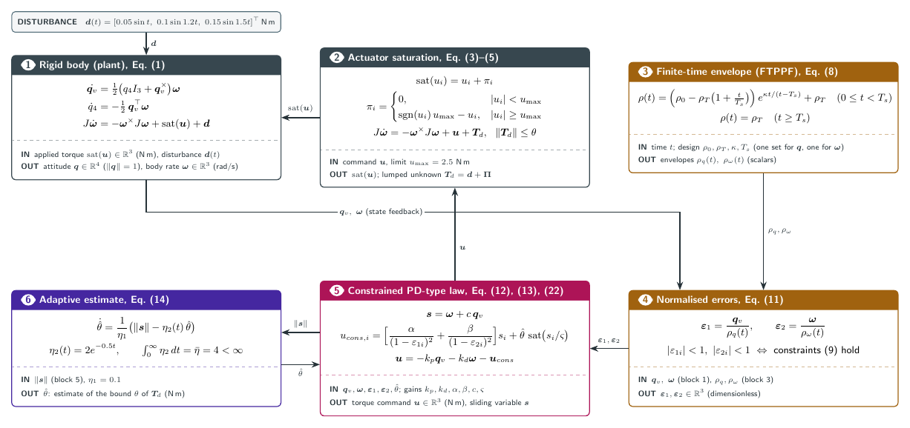<br/>
  <em>How the six blocks connect. The body (block 1) is measured, its errors are compared with the tube (blocks 3–4), the controller computes a torque (blocks 5–6), and the motors deliver it up to their limit (block 2).</em>
</p>

---

### Block 1 — How a rigid body turns

**Idea.** Two facts describe a turning body. *Kinematics* (pure geometry): if the body spins at rate $`\boldsymbol{\omega}`$, its attitude changes in a known way. *Dynamics* (physics): a torque changes the spin, and a body spinning about two axes at once starts spinning about the third by itself (the gyroscopic effect you feel when you tilt a spinning bicycle wheel).

**Equation (1) of the paper:**

```math
\dot{\mathbf{q}}_v = \tfrac{1}{2}\left(q_4 I_3 + \mathbf{q}_v^{\times}\right)\boldsymbol{\omega}, \qquad
\dot{q}_4 = -\tfrac{1}{2}\,\mathbf{q}_v^{\top}\boldsymbol{\omega}
```

```math
J\,\dot{\boldsymbol{\omega}} = -\,\boldsymbol{\omega}^{\times} J\,\boldsymbol{\omega} + \mathbf{u} + \mathbf{d}
```

| Symbol | Meaning | Size | Unit |
| :--- | :--- | :--- | :--- |
| q = [q_v, q_4] | attitude quaternion | 4 numbers | – |
| ω | angular velocity (spin rate) of the body | 3 numbers | rad/s |
| J | inertia matrix: how hard the body is to spin about each axis | 3 × 3 | kg·m² |
| u | control torque (what the controller asks for) | 3 numbers | N·m |
| d | disturbance torque (unknown push from outside) | 3 numbers | N·m |
| I₃ | 3 × 3 identity matrix | 3 × 3 | – |
| a× | the cross product written as a matrix: a× b = a × b | 3 × 3 | – |

**In words.** The first line says how the attitude moves when the body spins. The second line is Newton's second law for rotation, *inertia × angular acceleration = torque*, with the extra gyroscopic term $`-\boldsymbol{\omega}^{\times}J\boldsymbol{\omega}`$.

**Worked example at $`t = 0`$.** Plugging in the starting state:

```math
\dot{\mathbf{q}}_v = [0.01728,\; 0.00660,\; -0.00043]\ \text{s}^{-1}, \qquad \dot{q}_4 = -0.00275\ \text{s}^{-1}
```

With the torque the controller will apply (block 5 shows it is clipped to $`[-2.5,\, 2.5,\, 2.5]`$ N·m) the spin accelerates by $`\dot{\boldsymbol{\omega}} = [-0.141,\; 0.144,\; 0.162]`$ rad/s². Even at full torque the heavy spacecraft speeds up by only about 0.15 rad/s every second. This small number later decides which tubes are achievable.

**Paper's spacecraft:**

```math
J = \begin{bmatrix} 20 & 1.2 & 0.9 \\ 1.2 & 17 & 1.4 \\ 0.9 & 1.4 & 15 \end{bmatrix}\ \text{kg·m}^2, \qquad
\mathbf{d}(t) = \begin{bmatrix} 0.05\sin t \\ 0.1\sin 1.2t \\ 0.15\sin 1.5t \end{bmatrix}\ \text{N·m}
```

**In our code:** `rhs()` in [`paper_reproduction.py`](paper_reproduction.py), integrated with the 4th-order Runge–Kutta method (RK4) at a 1 ms step; independently in MATLAB `toy_model/step6_spacecraft_closed_loop.m`.

---

### Block 2 — Motors have limits

**Idea.** Reaction wheels and rotors have a maximum torque. Anything the controller asks for beyond it is simply not delivered. The paper does not ignore this: it treats the missing torque as one more unknown disturbance.

**Equations (3)–(5):**

```math
\operatorname{sat}(u_i) = u_i + \pi_i, \qquad
\pi_i = \begin{cases} 0, & |u_i| < u_{\max} \\ \operatorname{sgn}(u_i)\,u_{\max} - u_i, & |u_i| \ge u_{\max} \end{cases}
```

```math
J\,\dot{\boldsymbol{\omega}} = -\,\boldsymbol{\omega}^{\times} J\,\boldsymbol{\omega} + \mathbf{u} + \mathbf{T}_d,
\qquad \mathbf{T}_d = \mathbf{d} + \boldsymbol{\Pi}, \qquad \lVert \mathbf{T}_d \rVert \le \theta
```

| Symbol | Meaning | Unit |
| :--- | :--- | :--- |
| u_max | largest torque each axis can produce (paper: 2.5) | N·m |
| π_i | torque lost on axis i because of the limit | N·m |
| T_d | everything the controller does not know: disturbance + lost torque | N·m |
| θ | an upper bound on the size of T_d, **unknown** to the controller | N·m |

**In words.** "Delivered torque = requested torque + a correction". Moving the correction into the unknown part makes the body look as if it received the *requested* torque plus one bounded unknown push, which block 6 learns to fight.

**Worked example at $`t = 0`$.** Block 5 will request $`\mathbf{u}(0) = [-10.537,\; 5.710,\; 10.414]`$ N·m. Every axis is above 2.5, so the motors deliver $`[-2.5,\; 2.5,\; 2.5]`$ and the lost torque is $`\boldsymbol{\Pi} = [8.037,\; -3.210,\; -7.914]`$ N·m. At the start, the "unknown" is dominated by saturation, not by the disturbance (which is at most 0.187 N·m).

---

### Block 3 — The finite-time "tube" (FTPPF)

**Idea.** Draw a tube around zero that starts wide and narrows. The paper's new tube, the **finite-time prescribed performance function (FTPPF)**, reaches its final width *exactly* at a chosen time $`T_s`$ and then stays constant.

**Equations (6), (8), (9):** each component must stay inside its tube,

```math
-\rho_q(t) < q_i(t) < \rho_q(t), \qquad -\rho_\omega(t) < \omega_i(t) < \rho_\omega(t), \qquad i = 1, 2, 3
```

and the tube half-width is

```math
\rho(t) =
\begin{cases}
\left(\rho_0 - \rho_T\left(1 + \dfrac{t}{T_s}\right)\right)\exp\!\left(\dfrac{\kappa\, t}{t - T_s}\right) + \rho_T, & 0 \le t < T_s \\[10pt]
\rho_T, & t \ge T_s
\end{cases}
```

| Symbol | Meaning | Paper's value (attitude / rate) |
| :--- | :--- | :--- |
| ρ₀ | starting half-width = largest allowed error at t = 0 | 0.3 / 0.4 rad/s |
| ρ_T | final half-width = guaranteed accuracy after T_s | 0.008 / 0.005 rad/s |
| T_s | the deadline: time at which the tube reaches its final width | 15 s or 10 s |
| κ | shape: how early the tube starts closing | 2.5 |

**Why it works (three checks you can do by hand):**

1. **Start.** At $`t = 0`$ the exponent is $`0`$ and $`e^0 = 1`$, so $`\rho(0) = \rho_0`$.
2. **Arrives exactly at $`T_s`$.** As $`t`$ approaches $`T_s`$ from below, $`t - T_s`$ becomes a tiny negative number, so the exponent goes to $`-\infty`$ and $`\exp(\cdot) \to 0`$. Hence $`\rho \to \rho_T`$, matching the second line. The classical tube $`(\rho_0 - \rho_\infty)e^{-\kappa t} + \rho_\infty`$ (paper Eq. 7) only gets there as $`t \to \infty`$.
3. **Never widens.** Its derivative is negative for $`0 \le t < T_s`$ whenever $`\rho_0 > 2\rho_T`$ (true for all tubes we use).

**Worked example: attitude tube at $`t = 2`$ s, $`T_s = 15`$ s.**

```math
\rho_0 - \rho_T\left(1 + \tfrac{2}{15}\right) = 0.3 - 0.008 \times 1.1333 = 0.290933
```

```math
\exp\!\left(\frac{2.5 \times 2}{2 - 15}\right) = e^{-0.38462} = 0.680712
```

```math
\rho_q(2) = 0.290933 \times 0.680712 + 0.008 = \mathbf{0.206042}
```

So after 2 s every attitude component must be smaller than 0.206. Along the way: $`\rho_q = 0.300,\ 0.252,\ 0.206,\ 0.091,\ 0.0245,\ 0.0099,\ 0.0080`$ at $`t = 0, 1, 2, 5, 8, 10, 12`$ s.

<p align="center">
  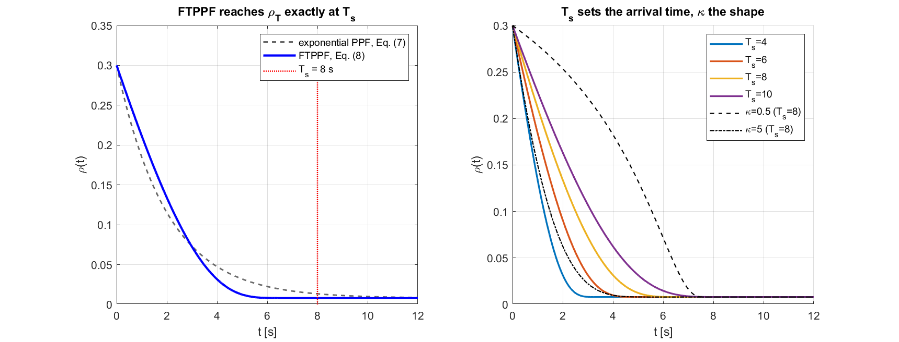<br/>
  <em>MATLAB step 1. Left: the finite-time tube (blue) reaches its final width exactly at T_s = 8 s, while the classical exponential tube (dashed) is still 1.67 times too wide. Right: a shorter T_s closes the tube earlier, and κ changes its shape.</em>
</p>

---

### Block 4 — How close am I to the wall? (normalised errors)

**Idea.** Instead of a complicated transformation, simply divide each error by the current tube half-width. The result is "what fraction of the allowed room is used". Inside the tube means a value between $`-1`$ and $`1`$.

**Equation (11):**

```math
\boldsymbol{\varepsilon}_1 = \frac{\mathbf{q}_v(t)}{\rho_q(t)}, \qquad
\boldsymbol{\varepsilon}_2 = \frac{\boldsymbol{\omega}(t)}{\rho_\omega(t)}, \qquad
\text{inside the tube} \iff |\varepsilon_{1i}| < 1 \ \text{and}\ |\varepsilon_{2i}| < 1 \ \text{for every axis } i
```

**Worked example at $`t = 0`$** ($`\rho_q = 0.3`$, $`\rho_\omega = 0.4`$):

```math
\boldsymbol{\varepsilon}_1 = \frac{[0.2,\; -0.15,\; -0.25]}{0.3} = [0.6667,\; -0.5,\; -0.8333], \qquad
\boldsymbol{\varepsilon}_2 = \frac{[0.03,\; 0.02,\; -0.01]}{0.4} = [0.075,\; 0.05,\; -0.025]
```

All six are below 1 in size: the start is allowed. Axis 3 already uses 83 % of its attitude room.

---

### Block 5 — The control law

**Idea.** A spring and a damper (the PD part) do the main work. On top of that, a second, **variable** damper acts on the combined signal $`\mathbf{s} = \boldsymbol{\omega} + c\,\mathbf{q}_v`$: it is weak in the middle of the tube and becomes enormous near the wall. Finally $`\hat{\theta}\,\operatorname{sat}(\mathbf{s}/\varsigma)`$ adds a push of size $`\hat{\theta}`$ against the unknown torque.

**Equations (12), (13) and (22):**

```math
\mathbf{u} = \underbrace{-\,k_p\,\mathbf{q}_v - k_d\,\boldsymbol{\omega}}_{\text{ordinary PD}} \;-\; \mathbf{u}_{cons},
\qquad \mathbf{s} = \boldsymbol{\omega} + c\,\mathbf{q}_v
```

```math
u_{cons,i} = \underbrace{\left[\frac{\alpha}{(1 - \varepsilon_{1i})^{2}} + \frac{\beta}{(1 - \varepsilon_{2i})^{2}}\right]}_{\text{barrier gain } g_i} s_i
\;+\; \hat{\theta}\,\operatorname{sat}\!\left(\frac{s_i}{\varsigma}\right)
```

| Symbol | Meaning | Paper's value |
| :--- | :--- | :--- |
| k_p | spring stiffness (proportional gain) | 40 |
| k_d | damping (derivative gain) | 20 |
| s | "sliding variable": compares the actual spin with a target spin −c·q_v that would bring the error to zero | – |
| c | how strongly the attitude error enters s | 0.5 (not stated in the paper, our choice) |
| α, β | weights of the attitude and rate barriers | 1.5, 1.2 |
| g_i | barrier gain of axis i: about α+β = 2.7 in the middle of the tube, → ∞ at the wall | – |
| θ̂ | learned size of the unknown torque (block 6) | starts at 0 |
| ς | width of the smooth zone that replaces sgn(s) to avoid chattering | 0.02 (our choice) |

**How the barrier keeps the body inside.**

- In the middle of the tube ($`\varepsilon \approx 0`$), $`g_i \approx 2.7`$, small next to $`k_d = 20`$: the controller behaves like plain PD.
- Near the wall ($`\varepsilon \to 1`$), $`(1 - \varepsilon)^{-2} \to \infty`$ and the barrier term dominates. Strong negative feedback on $`s_i`$ forces $`\omega_i`$ towards $`-c\,q_i`$: the body turns **back towards the target** and its speed is capped.
- When $`\mathbf{s} = 0`$ we have $`\boldsymbol{\omega} = -c\,\mathbf{q}_v`$, which by block 1 makes the attitude error decay. So pushing $`\mathbf{s}`$ to zero also pushes the attitude error to zero.

**Worked example at $`t = 0`$** ($`\hat{\theta} = 0`$):

```math
\mathbf{s} = [0.03 + 0.1,\; 0.02 - 0.075,\; -0.01 - 0.125] = [0.13,\; -0.055,\; -0.135]\ \text{rad/s}
```

```math
-40\,\mathbf{q}_v - 20\,\boldsymbol{\omega} = [-8.6,\; 5.6,\; 10.2]\ \text{N·m}
```

```math
g_1 = \frac{1.5}{(1 - 0.6667)^2} + \frac{1.2}{(1 - 0.075)^2} = 13.500 + 1.403 = 14.903, \qquad g_2 = 1.996, \qquad g_3 = 1.588
```

```math
\mathbf{u} = [-8.6,\; 5.6,\; 10.2] - [1.937,\; -0.110,\; -0.214] = [-10.537,\; 5.710,\; 10.414]\ \text{N·m}
```

Every axis exceeds 2.5 N·m, so the motors deliver $`[-2.5,\; 2.5,\; 2.5]`$ (block 2).

> **A detail the paper leaves open.** Written literally, $`(1 - \varepsilon)^{-2}`$ grows only as $`\varepsilon \to +1`$; as $`\varepsilon \to -1`$ it tends to $`1/4`$. The paper's barrier therefore protects the upper wall much more strongly than the lower wall (in the example above, axis 3 is closest to its wall but gets the smallest gain because $`\varepsilon_{13} < 0`$). A symmetric alternative, $`\alpha(1 - \varepsilon^2)^{-2}`$, grows at both walls. We always use the **paper's form as the reference** and report the symmetric form as a clearly labelled variant.

<p align="center">
  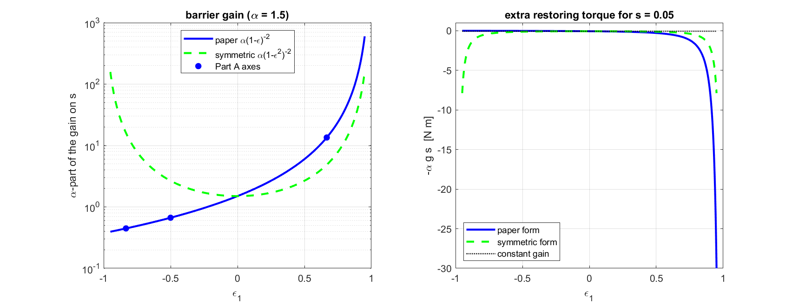<br/>
  <em>MATLAB step 2. Left: the paper's barrier gain grows only towards ε = +1; the symmetric form grows at both walls. Right: the extra restoring torque for s = 0.05.</em>
</p>

**In our code:** `control()` in [`paper_reproduction.py`](paper_reproduction.py) with `mode = "constrained"` (paper form), `"symmetric"` or `"pd"` (barrier and adaptive term switched off).

---

### Block 6 — Learning the disturbance (adaptive law)

**Idea.** The controller does not know how big the disturbance plus the lost torque is, so it **learns** a number $`\hat{\theta}`$. It grows while $`\mathbf{s}`$ is not zero ("something is still pushing me away") and is gently pulled back by a "leakage" term.

**Equation (14):**

```math
\dot{\hat{\theta}} = \frac{1}{\eta_1}\left(\lVert \mathbf{s} \rVert - \eta_2(t)\,\hat{\theta}\right),
\qquad \eta_1 > 0, \qquad \int_0^{\infty} \eta_2(\tau)\, d\tau < \infty
```

Paper's choice: $`\eta_1 = 0.1`$, $`\eta_2(t) = 2e^{-0.5t}`$, $`\hat{\theta}(0) = 0`$.

**Worked example: one 1 ms step from $`\hat{\theta} = 0`$.** $`\lVert \mathbf{s}(0) \rVert = \sqrt{0.13^2 + 0.055^2 + 0.135^2} = 0.19532`$, so

```math
\hat{\theta}(0.001) = 0 + 0.001 \times \frac{0.19532 - 0}{0.1} = 0.0019532\ \text{N·m}
```

> **What we observed.** Because the leakage $`\eta_2`$ fades away, $`\hat{\theta}`$ can creep upward slowly while a tiny residual $`\lVert \mathbf{s} \rVert`$ remains ("parameter drift"). In the paper's 20 s horizon this is harmless ($`\hat{\theta} \approx 0.43`$ at 20 s). On the X3, which flies for 180 s, we keep a minimum leakage of 0.2 and cap $`\hat{\theta}`$ at 0.1 N·m.

<p align="center">
  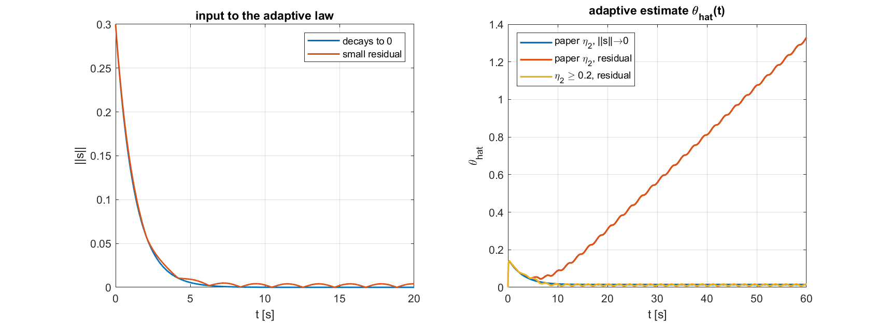<br/>
  <em>MATLAB step 4. θ̂ for a decaying ‖s‖ (settles), for a small persistent residual (drifts upward), and with a leakage floor η₂ ≥ 0.2 (stays bounded).</em>
</p>

---

### Theorem 1 — Why the body settles

The paper proves that, with blocks 1–6, the attitude error and the spin rate both go to zero. The proof uses a **Lyapunov function**, an "energy" built from the error, the spin and the learning error $`\tilde{\theta} = \theta - \hat{\theta}`$:

```math
V = (k_p + c\,k_d)\left(\mathbf{q}_v^{\top}\mathbf{q}_v + (1 - q_4)^2\right) + \tfrac{1}{2}\,\boldsymbol{\omega}^{\top} J\,\boldsymbol{\omega} + c\,\mathbf{q}_v^{\top} J\,\boldsymbol{\omega} + \tfrac{\eta_1}{2}\,\tilde{\theta}^{2}
```

**The argument in plain words:**

1. $`V`$ is never negative and is zero only at the target (like the height of a ball in a bowl).
2. Along the motion, $`V`$ can only go down (apart from a small term that fades away because $`\eta_2`$ fades away). The barrier term only helps, because it always removes energy.
3. A quantity that only goes down and cannot go below zero must level off; a standard result (Barbalat's lemma) then shows that the error and the spin rate tend to zero.

The proof needs two conditions on $`c`$, which our choice $`c = 0.5`$ satisfies with the paper's numbers ($`\lambda_{\min}(J) = 14.27`$, $`\lambda_{\max}(J) = 20.74`$ are the smallest and largest eigenvalues of $`J`$):

```math
k_d - c\,\lambda_{\max}(J) = 20 - 10.37 = 9.63 > 0, \qquad
2(k_p + c\,k_d)\,\lambda_{\min}(J) = 1427 > (c\,\lambda_{\max}(J))^2 = 107.5
```

> **What the theorem does and does not prove.** It proves **convergence** to the target. It does **not** separately prove that the state never leaves the tube; the paper supports that with remarks and simulations. We therefore say "constraint satisfaction **observed and measured** in simulation", and we measure it in every experiment.

---

## 4. From a satellite to a quadcopter (blocks 7–10)

The paper controls a body that can produce torque about every axis directly and does not need to hold itself up. A quadcopter is different:

- its four rotors produce **one upward thrust plus three torques**, so it moves sideways by tilting;
- Gazebo publishes only the drone's **position and attitude**, not its spin rate;
- the controller runs as a **digital loop at about 60 Hz** with one sample of delay.

Blocks 7–10 are what we added so that blocks 3–6 can run unchanged on the X3. The attitude physics of the X3 *is* the paper's Eq. (1), with a 250 times smaller inertia ($`J = \operatorname{diag}(0.03565,\ 0.07035,\ 0.09892)`$ kg·m², mass 1.52 kg).

<p align="center">
  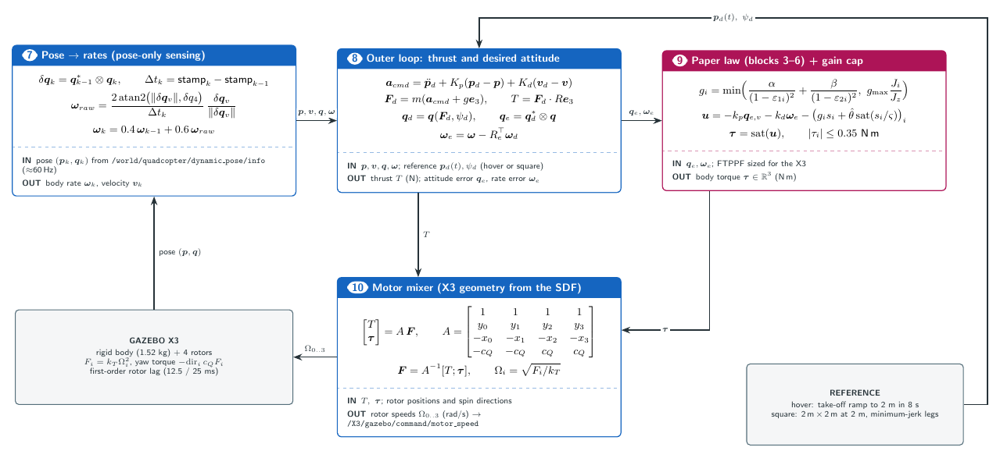<br/>
  <em>The controller on the X3: pose from Gazebo → body rate (block 7) → position loop and desired attitude (block 8) → the paper's law adapted to a 60 Hz loop (block 9) → four rotor speeds (block 10).</em>
</p>

### Block 7 — Spin rate from two attitude samples

If we know the attitude now and one sample ago, the small rotation between them divided by the time step is the spin rate. That small rotation must be computed **in the drone's own frame**:

```math
\delta\mathbf{q}_k = \mathbf{q}_{k-1}^{*} \otimes \mathbf{q}_k, \qquad
\boldsymbol{\omega}_{raw} = \frac{2\,\operatorname{atan2}\!\left(\lVert \delta\mathbf{q}_v \rVert,\, \delta q_4\right)}{\Delta t_k}\,\frac{\delta\mathbf{q}_v}{\lVert \delta\mathbf{q}_v \rVert}, \qquad
\boldsymbol{\omega}_k = 0.4\,\boldsymbol{\omega}_{k-1} + 0.6\,\boldsymbol{\omega}_{raw}
```

$`\otimes`$ is quaternion multiplication (it combines two rotations), $`\mathbf{q}^{*}`$ is the inverse rotation, and $`\Delta t_k`$ comes from the simulator's time stamps. The last step is a light smoothing filter.

> **Why our first version failed here.** With the drone yawed by 90° and rolling at 0.6 rad/s, the exact formula gives $`[0.600,\ 0,\ 0]`$ rad/s. Our first node simply subtracted quaternion components and got $`[0.424,\ 0.424,\ -0.001]`$: the roll was reported as half roll, half pitch. The naive formula is correct only when the drone has no yaw.

### Block 8 — Where to go, and therefore how to tilt

A PD law on position gives the acceleration we want; adding gravity gives the direction the thrust must point; that direction fixes the desired attitude $`\mathbf{q}_d`$.

```math
\mathbf{a}_{cmd} = \ddot{\mathbf{p}}_d + K_p(\mathbf{p}_d - \mathbf{p}) + K_d(\mathbf{v}_d - \mathbf{v}), \qquad
\mathbf{F}_d = m\left(\mathbf{a}_{cmd} + g\,\mathbf{e}_3\right), \qquad
T = \mathbf{F}_d^{\top} R\,\mathbf{e}_3
```

Here $`\mathbf{p}`$, $`\mathbf{v}`$ are position and velocity, the subscript $`d`$ means "desired", $`\mathbf{e}_3 = [0,0,1]`$ points up, $`R`$ is the drone's current rotation and $`T`$ the total thrust. The desired body z-axis points along $`\mathbf{F}_d`$, and the attitude error fed to the paper's law is $`\mathbf{q}_e = \mathbf{q}_d^{*} \otimes \mathbf{q}`$.

> **Example.** The target is 10 cm away along x and the drone is at rest: $`\mathbf{a}_{cmd} = [0.12,\ 0,\ 0]`$ m/s², $`\mathbf{F}_d = 1.52 \times [0.12,\ 0,\ 9.81] = [0.182,\ 0,\ 14.911]`$ N. The drone must lean $`\arctan(0.182 / 14.911) = 0.70^\circ`$ towards the target, with a thrust of 14.91 N (its weight).

### Block 9 — The paper's law on a 60 Hz digital loop

The paper's barrier gain may grow without limit near the wall. A digital loop that sees the drone only every 1/60 s and acts one sample late cannot use an unlimited damping gain: beyond a certain value every correction overshoots more than the last, and it oscillates. We computed that limit exactly by checking the eigenvalues of the sampled closed loop (a loop is stable when all eigenvalues have magnitude below 1):

```math
\mathbf{x}_{k+1} = \begin{bmatrix} 1 & T \\ 0 & 1 \end{bmatrix}\mathbf{x}_k + \begin{bmatrix} T^2/(2J) \\ T/J \end{bmatrix} u_{k-1}, \qquad
u_k = -\tfrac{k_p}{2}\,\phi_k - k_{d,tot}\,\dot{\phi}_k, \qquad T = \tfrac{1}{60}\ \text{s}
```

Here $`\mathbf{x}_k = [\phi_k,\ \dot{\phi}_k]`$ is the angle and angular speed of one axis at sample $`k`$, and $`k_{d,tot}`$ is the total gain on the rate (PD damping plus barrier gain). Result: $`k_{d,tot}`$ must stay below **2.12** (roll), **4.20** (pitch) and **5.91** (yaw) N·m·s. We therefore cap the barrier gain:

```math
g_i = \min\!\left(\frac{\alpha}{(1 - \varepsilon_{1i})^2} + \frac{\beta}{(1 - \varepsilon_{2i})^2},\;\; g_{\max}\frac{J_i}{J_z}\right)
```

With the cap the largest total gains are 0.76, 1.11 and 1.40, well inside the limits. X3 values: $`k_p = 4`$, $`k_d = 0.4`$, $`\alpha = 0.15`$, $`\beta = 0.12`$, $`c = 1`$; tubes $`\rho_q: 0.30 \to 0.02`$, $`\rho_\omega: 2.5 \to 0.05`$ rad/s, $`T_s = 10`$ s.

<p align="center">
  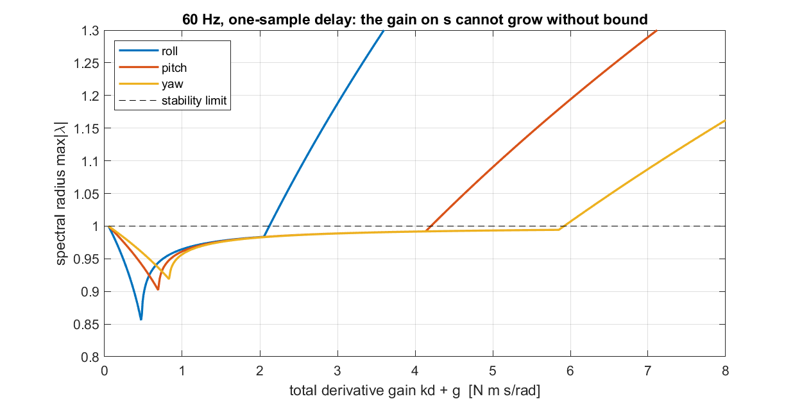<br/>
  <em>MATLAB step 8. Spectral radius (largest eigenvalue magnitude) of the 60 Hz loop against the total rate gain. Above the dashed line the loop is unstable.</em>
</p>

### Block 10 — From thrust and torque to four rotor speeds

Each rotor pushes up with force $`F_i = k_T\,\Omega_i^2`$, where $`\Omega_i`$ is its speed in rad/s. A rotor off-centre also creates a roll or pitch torque, and each rotor's air drag twists the body about z. These four sums form a 4 × 4 matrix built from the X3's rotor positions; inverting it gives the four forces that produce exactly the requested thrust and torques:

```math
\begin{bmatrix} T \\ \tau_x \\ \tau_y \\ \tau_z \end{bmatrix} = A\,\mathbf{F}, \qquad
A = \begin{bmatrix} 1 & 1 & 1 & 1 \\ -0.22 & 0.20 & 0.22 & -0.20 \\ -0.13 & 0.13 & -0.13 & 0.13 \\ -0.016 & -0.016 & 0.016 & 0.016 \end{bmatrix}, \qquad
\mathbf{F} = A^{-1}\begin{bmatrix} T \\ \boldsymbol{\tau} \end{bmatrix}, \qquad \Omega_i = \sqrt{F_i / k_T}
```

> **Example.** Hovering needs $`T = mg = 1.52 \times 9.81 = 14.911`$ N, so each rotor carries 3.728 N and spins at $`\sqrt{3.728 / 8.54858\times10^{-6}} = 660.4`$ rad/s (limit 800). The largest torque the X3 can make while hovering is 1.464 (roll), 0.907 (pitch) and only **0.106 N·m (yaw)**. The paper's disturbance has a 0.15 N·m yaw component: more than the X3 can ever cancel, so at the paper's full disturbance **no controller** can satisfy the yaw limit on this drone.

<p align="center">
  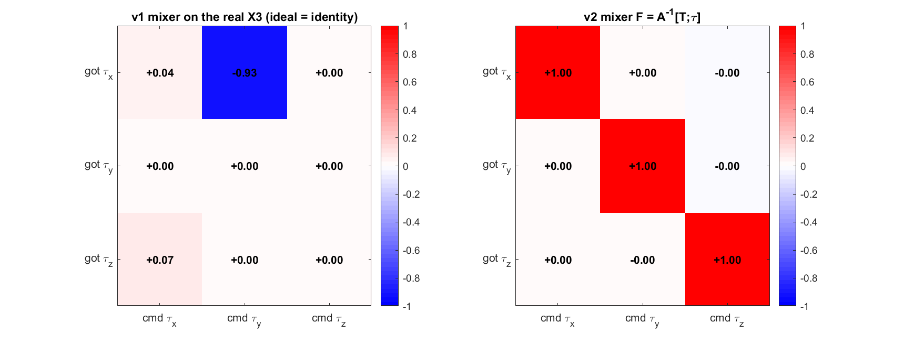<br/>
  <em>MATLAB step 7. Torque produced per unit torque commanded. Left: our first mixer (a pitch command produced roll, and nothing produced pitch). Right: the corrected mixer from the X3's geometry gives exactly the identity (each command produces exactly what was asked).</em>
</p>

---

## 5. Results

All numbers below come from [`docs/results/`](docs/results/) and were produced by the scripts in this repository. Re-running the scripts reproduces them exactly. "Time outside" means the percentage of simulated time during which at least one component was outside its tube; **0 % means the limits were respected the whole time.**

### 5.1 Reproduction of the paper, Part 1

The paper's first test: spacecraft from $`\mathbf{q}(0) = [0.2,\,-0.15,\,-0.25,\,0.9354]`$, $`\boldsymbol{\omega}(0) = [0.03,\,0.02,\,-0.01]`$ rad/s, with the deadline set to 15 s and then 10 s.

| Metric | T_s = 15 s | T_s = 10 s |
| :--- | :---: | :---: |
| Time outside the attitude tube | **0 %** | **0 %** |
| Time outside the spin-rate tube | **0 %** | **0 %** |
| Largest fraction of attitude room used, max abs(ε₁) | 0.871 | 0.924 |
| Largest fraction of rate room used, max abs(ε₂) | 0.912 | 0.942 |
| Settling time (attitude error below 0.01 for good) | 5.25 s | 4.53 s |
| Final spin rate | 0.0040 rad/s | 0.0041 rad/s |

<p align="center">
  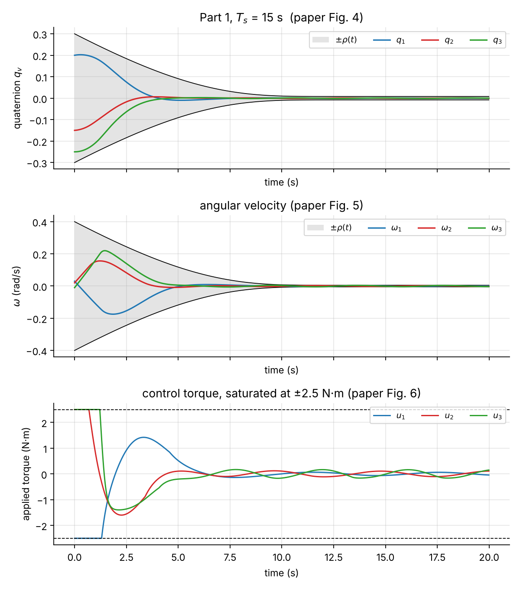
  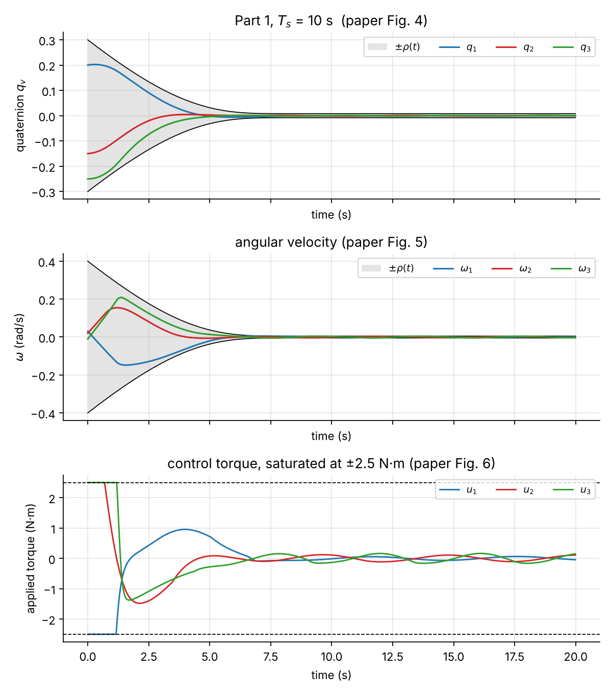<br/>
  <em>Part 1, T_s = 15 s (left) and 10 s (right). Top: attitude inside its tube. Middle: spin rate inside its tube. Bottom: torque, clipped at ±2.5 N·m during the first second.</em>
</p>

### 5.2 Reproduction of the paper, Part 2: constrained law versus plain PD

The paper's second test compares its controller with a conventional PD controller **using the same 2.5 N·m motors**.

| Metric | Paper's law | Symmetric variant | Conventional PD |
| :--- | :---: | :---: | :---: |
| Time outside the spin-rate tube | **0 %** | **0 %** | **27.5 %** |
| Largest fraction of rate room used | 0.904 | 0.837 | **1.496** (outside) |
| Time at the torque limit | 6.3 % | 7.2 % | 14.0 % |
| Settling time | 5.79 s | 4.19 s | 6.31 s |
| Torque energy (integral of squared torque) | **38.9** | 41.5 | 60.5 |
| Final spin rate | 0.0040 rad/s | 0.0040 rad/s | 0.0083 rad/s |

The paper's law respects the speed limit the whole time, settles faster and uses **36 % less torque energy** than PD.

<p align="center">
  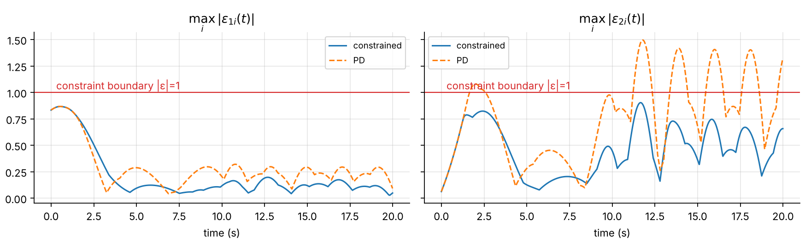<br/>
  <em>The clearest view of the constraint: the largest fraction of the allowed room used, over time. Below the red line means inside. Conventional PD crosses it for the spin rate.</em>
</p>

<p align="center">
  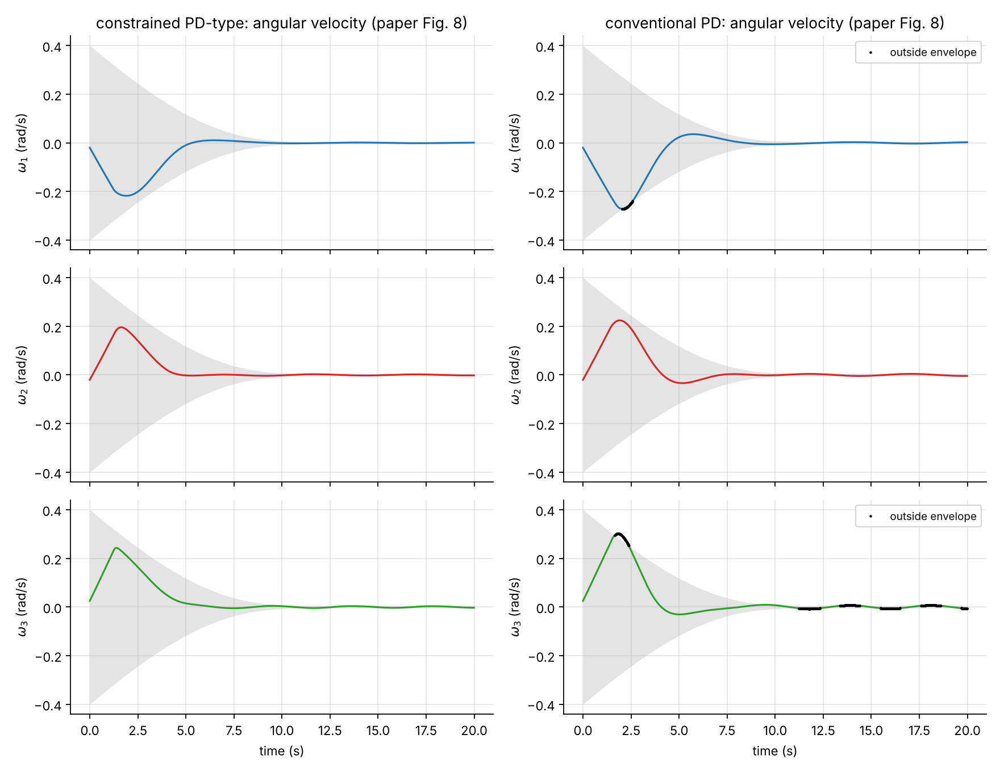<br/>
  <em>Part 2, spin rate. Black dots: conventional PD outside its tube, during the manoeuvre and in steady state. The paper's law stays inside throughout.</em>
</p>

<p align="center">
  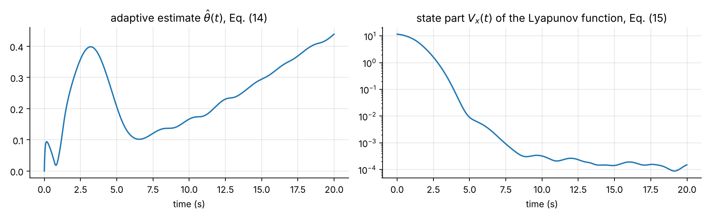<br/>
  <em>Left: the learned disturbance size θ̂(t). Right: the "energy" V of Theorem 1 falls by five orders of magnitude within 9 s, then stays at a small floor set by the persistent disturbance.</em>
</p>

### 5.3 Beyond the paper: 900 random simulations

The paper shows two single runs. To check whether its conclusions hold in general, we ran three Monte-Carlo studies of 300 random starting conditions each (the same random draws for all three controllers, fixed seed so they are reproducible). "Violation-free" means the run never left either tube; the brackets are 95 % confidence intervals.

| Study | What was randomised | Paper's law | Symmetric variant | Conventional PD |
| :--- | :--- | :---: | :---: | :---: |
| **A** — paper's conditions | starting attitude anywhere inside 90 % of the tube, small starting spin | **97.0 %** [94.4, 98.4] | 97.7 % | 0.0 % |
| **B** — stronger disturbance | disturbance 0.5× to 3× the paper's | 21.3 % | **97.3 %** | 3.0 % |
| **C** — fast starting spin | starting spin up to 0.36 rad/s | 50.3 % | 51.3 % | 0.0 % |

<p align="center">
  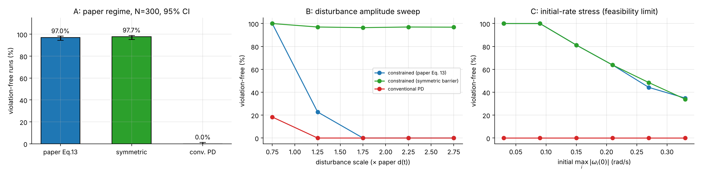<br/>
  <em>Fraction of runs that never left the tubes. A: paper's conditions. B: by disturbance strength. C: by starting spin rate.</em>
</p>

**What this means.**

- Under the paper's conditions the controller works as claimed in 97 % of random cases, while PD never does.
- Up to the paper's disturbance level, the paper's law succeeds in 100 % of study-B runs. Above it, its one-sided barrier loses the lower wall (23 % success between 1× and 1.5×, 0 % beyond), while the symmetric variant keeps working in about 97 % of runs at every level.
- When the starting spin is fast, the heavy spacecraft simply cannot brake hard enough with 2.5 N·m: success falls to 35 % at the fastest spins. This is a physical limit of the motors, not a coding error (see [section 6](#6-what-we-found-that-the-paper-does-not-say)).

<p align="center">
  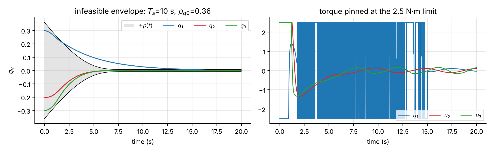<br/>
  <em>A tube that is too tight for the motors (T_s = 10 s with a narrow starting width): the barrier asks for more than 2.5 N·m, the torque stays pinned at the limit, and the constraint is lost. No controller could do better with these motors.</em>
</p>

### 5.4 The X3 quadcopter

**Why our first Gazebo node crashed.** We switched each fix on separately to find the cause (experiment E1):

| Version | Crashed? | Note |
| :--- | :---: | :--- |
| Version 1 as it was | yes, after 5.1 s | mixer signs did not match the X3 → no pitch control |
| + altitude-rate fix only | yes, after 5.7 s | climbs, then tips over |
| + mixer fix only | yes, after 5.1 s | vertical speed still computed wrongly |
| + mixer fix + altitude-rate fix | **no** | hovers, tilt error 2.0° |
| + exact spin-rate formula (block 7) | **no** | tilt error **0.007°** |

So the crash had **two independent causes**: a mixer whose signs did not match the X3's rotor numbering, and a bug in how the vertical speed was computed. The naive spin-rate formula made the tilt error 300 times larger.

<p align="center">
  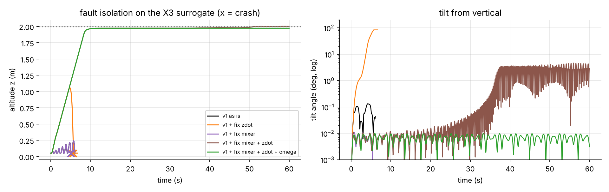<br/>
  <em>Fault isolation: version 1 with each fix switched on separately (× = crash).</em>
</p>

**The corrected controller:**

| Experiment | Result |
| :--- | :--- |
| E2 — hover for 180 s, no disturbance | altitude error 0.02 mm (RMS), horizontal drift 0.2 mm, **0 %** time outside either tube |
| E3 — hover with half the paper's disturbance | time outside the spin-rate tube: PD **36.4 %** → paper's law **6.0 %** → symmetric variant **0 %** |
| E4 — fly a 2 m × 2 m square at 2 m height | position error **4.0 cm** RMS (7.9 cm max), 0 % outside the attitude tube |

<p align="center">
  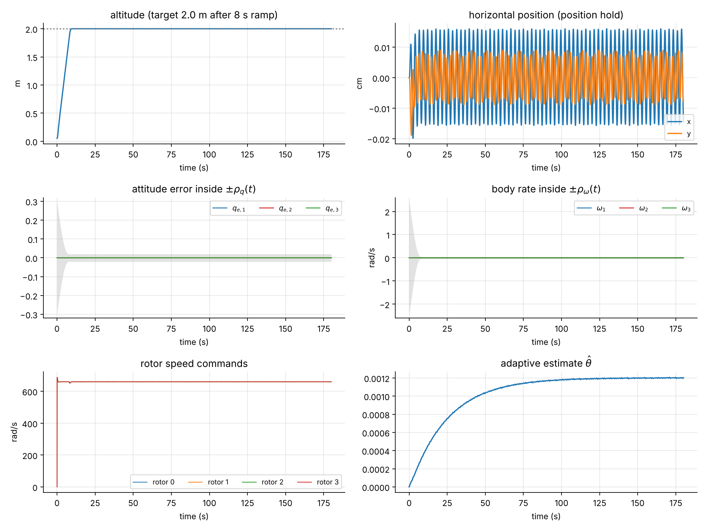<br/>
  <em>E2: the corrected controller hovering for 180 s. Altitude, position, attitude error and spin rate inside their tubes; rotor commands and θ̂.</em>
</p>

<p align="center">
  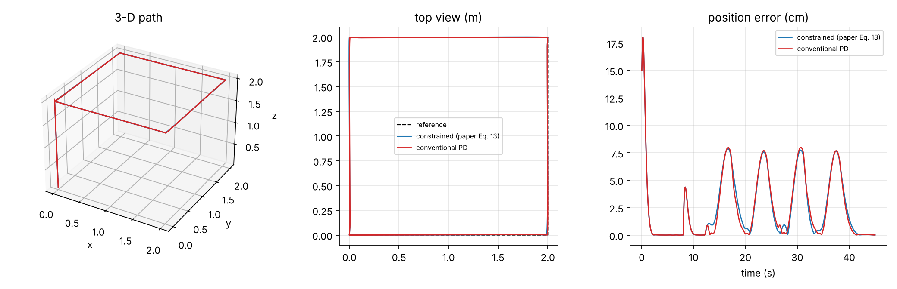<br/>
  <em>E4: a 2 × 2 m square at 2 m altitude. Left: 3-D path. Middle: top view. Right: position error.</em>
</p>

<p align="center">
  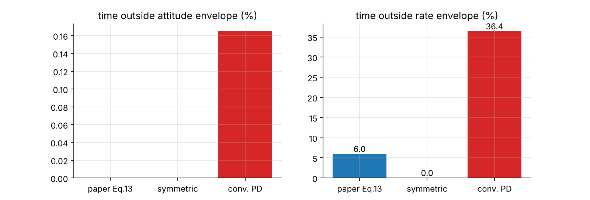<br/>
  <em>E3: percentage of time outside each tube with half the paper's disturbance.</em>
</p>

### 5.5 Demos

- **MuJoCo 3-D simulations** ([`Drones_Mujoco_Flying.ipynb`](Drones_Mujoco_Flying.ipynb), [`Drones_Mujoco_Pointing_Trial.ipynb`](Drones_Mujoco_Pointing_Trial.ipynb), [`Drones_Mujoco_Good_Trial.ipynb`](Drones_Mujoco_Good_Trial.ipynb), [`One_drone_alligning.ipynb`](One_drone_alligning.ipynb)): the paper's Part 2 manoeuvre, turning to any attitude given as roll/pitch/yaw, pointing the nose at a target, and a point-to-point flight.
- **Browser simulator** ([`index.html`](index.html)): an interactive illustration of the controller (uses the symmetric barrier).
- **Video:** [`Drone_Simulation.mp4`](Drone_Simulation.mp4).

<p align="center">
  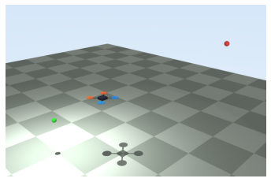
  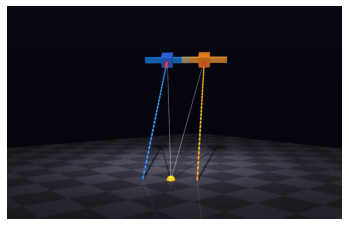<br/>
  <em>MuJoCo scenes: a quadrotor-shaped body flying to a goal (left) and two bodies pointing at a target (right).</em>
</p>

---

## 6. What we found that the paper does not say

A careful implementation exposes details that a paper leaves out. We report them openly; each is explained in detail in the full report.

1. **Four parameters are not stated.** The weight $`c`$, the smooth-zone width $`\varsigma`$, and the deadline $`T_s`$ and starting tube width $`\rho_{q0}`$ for Part 2. We chose $`c = 0.5`$ (it satisfies both conditions of Theorem 1), $`\varsigma = 0.02`$, $`T_s = 15`$ s and $`\rho_{q0} = 0.36`$.
2. **The Part 2 starting state lies exactly on the tube wall.** With the paper's $`\rho_{q0} = 0.3`$, the first component gives $`\varepsilon_{11}(0) = 0.3 / 0.3 = 1`$, so the barrier would divide by zero at $`t = 0`$. With $`\rho_{q0} = 0.36`$ the start is inside.
3. **The barrier is one-sided.** $`(1 - \varepsilon)^{-2}`$ protects only the upper wall strongly (block 5). This is why the paper's form fails under a strong disturbance (study B), and why the symmetric form exists as a variant.
4. **The tube must be achievable with the motors.** If the tube closes faster than the maximum torque can brake the body, no controller can stay inside (study C and the "infeasible envelope" figure).
5. **Theorem 1 proves convergence, not "never leaving the tube".** Staying inside is supported by simulations, which is exactly what we measure.

---

## 7. The MATLAB toy model

To make every idea tangible, [`toy_model/`](toy_model/) contains eight short MATLAB scripts. Each one prints its inputs and outputs with size, unit and meaning (tagged `[IN ]`, `[OUT]` or `[CHK]` for a check), reproduces the hand calculations of this README, and saves one figure. No toolbox is needed.

| Step | What it shows | Key number it prints |
| :--- | :--- | :--- |
| `step1_ftppf.m` | the finite-time tube | ρ_q(2) = 0.206042 |
| `step2_normalised_error.m` | normalised errors and both barrier forms | g₁ = 14.903 |
| `step3_control_law.m` | the whole control law at t = 0 | u = [−10.537, 5.710, 10.414] N·m |
| `step4_adaptive_law.m` | learning θ̂, drift, leakage floor | θ̂(1 ms) = 0.0019532 |
| `step5_single_axis.m` | the whole idea on one axis: constrained vs PD | — |
| `step6_spacecraft_closed_loop.m` | an independent re-implementation of the paper's Part 1 and Part 2 | the cross-check table below |
| `step7_x3_mixer.m` | the X3 mixer, hover speed, torque limits, the version 1 error | 660.4 rad/s |
| `step8_sampled_data_limit.m` | the largest stable gain on a 60 Hz loop | 2.12 / 4.20 / 5.91 |

**Run all of it:** in MATLAB, `run('toy_model/run_all.m')`. It writes `toy_model/figures/*.png` and the complete printed output to [`toy_model/results_log.txt`](toy_model/results_log.txt). We ran it in **MATLAB R2024a**: all eight steps completed without errors.

### Python versus MATLAB cross-check

Step 6 re-implements the paper's experiments in MATLAB with its own integrator and its own control-law code; only the equations and parameters are shared. The two implementations agree on **all 25** compared numbers (the largest difference, 0.001, is rounding):

| Case | Metric | Python | MATLAB |
| :--- | :--- | :---: | :---: |
| Part 1, T_s = 15 s | max abs(ε₁) / max abs(ε₂) | 0.871 / 0.912 | 0.871 / 0.912 |
| | time outside q / ω tube | 0.0 % / 0.0 % | 0.0 % / 0.0 % |
| | settling time | 5.25 s | 5.25 s |
| Part 1, T_s = 10 s | max abs(ε₁) / max abs(ε₂) | 0.924 / 0.941 | 0.924 / 0.942 |
| | time outside q / ω tube | 0.0 % / 0.0 % | 0.0 % / 0.0 % |
| | settling time | 4.53 s | 4.53 s |
| Part 2, paper's law | max abs(ε₂) | 0.904 | 0.904 |
| | time outside ω tube / at torque limit | 0.0 % / 6.3 % | 0.0 % / 6.3 % |
| | settling time / torque energy | 5.79 s / 38.9 | 5.79 s / 38.9 |
| Part 2, symmetric | max abs(ε₂) | 0.837 | 0.837 |
| | time outside ω tube / at torque limit | 0.0 % / 7.2 % | 0.0 % / 7.2 % |
| | settling time / torque energy | 4.19 s / 41.5 | 4.19 s / 41.5 |
| Part 2, conventional PD | max abs(ε₂) | 1.496 | 1.496 |
| | time outside ω tube / at torque limit | 27.5 % / 14.0 % | 27.5 % / 14.0 % |
| | settling time / torque energy | 6.31 s / 60.5 | 6.31 s / 60.5 |

<p align="center">
  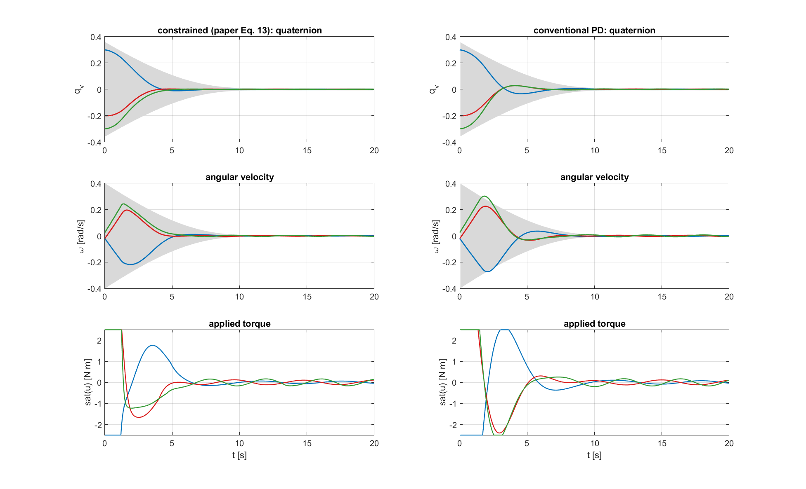<br/>
  <em>MATLAB step 6: the paper's Part 2, re-computed independently. Left: the paper's law. Right: conventional PD. Grey bands are the tubes.</em>
</p>

<p align="center">
  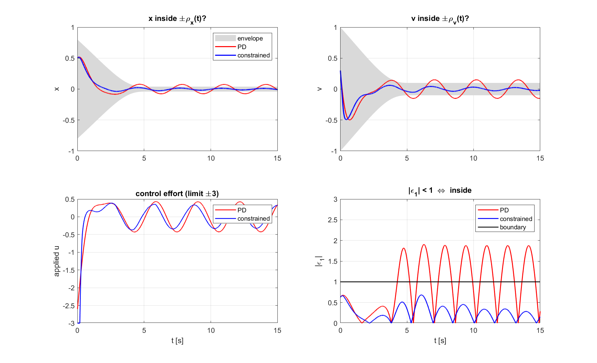<br/>
  <em>MATLAB step 5: the whole idea on a single axis. Same gains and the same torque limit for both controllers; only the constrained one stays inside the tube (bottom right: below 1 means inside).</em>
</p>

---

## 8. Repository layout

```
Drones_S5_AB02_PD_Control/
├── README.md                         this file
├── base paper.pdf                    the IEEE Access paper
├── paper_reproduction.py             reproduces the paper's Section IV + sensitivity + Monte-Carlo studies
├── gazebo.py                         ROS 2 node that flies the Gazebo X3 with the paper's controller
├── plot_gazebo_log.py                figures and metrics from a gazebo.py log
├── x3_sim/
│   ├── x3_model.py                   X3 physics built from Gazebo's X3 model files (mass, inertia, rotors, motor lag)
│   ├── controllers.py                version 1 (as it was) and the corrected controller
│   ├── trajectories.py               hover and square references
│   └── run_x3_experiments.py         experiments E0–E5
├── tests/
│   └── test_gazebo_node_offline.py   runs gazebo.py without ROS against the X3 model
├── toy_model/
│   ├── run_all.m                     runs steps 1–8, saves figures and the printed log
│   ├── step1_ftppf.m … step8_sampled_data_limit.m
│   ├── lib/                          shared MATLAB functions (tube, control law, parameters, printing)
│   ├── figures/                      MATLAB figures (8 PNG files)
│   └── results_log.txt               complete MATLAB output
├── docs/
│   ├── complete_documentation/       full report (PDF + LaTeX sources)
│   ├── mathematical_models/          equation guide (PDF + LaTeX sources + flow diagrams)
│   ├── figures/                      all Python figures
│   ├── results/                      all numbers (Markdown + JSON)
│   └── make_crosscheck.py            builds the Python-vs-MATLAB table
├── Drones_Mujoco_*.ipynb, One_drone_alligning.ipynb   MuJoCo 3-D demos
├── index.html, app.js, simulation.js, style.css       browser simulator
└── legacy/                           first versions kept for the record (e.g. gazebo_v1.py); not used as evidence
```

---

## 9. How to reproduce everything

**Python experiments** (Python 3 with NumPy and Matplotlib):

```bash
pip install numpy matplotlib
python paper_reproduction.py              # about 6 min  -> docs/figures/fig*.png, docs/results/metrics.*
python x3_sim/run_x3_experiments.py       # about 16 min -> docs/figures/x3_*.png, docs/results/x3_metrics.*
python tests/test_gazebo_node_offline.py  # about 2 min  -> checks gazebo.py without ROS
```

**MATLAB toy model** (no toolbox needed):

```matlab
run('toy_model/run_all.m')     % about 2 min -> toy_model/figures/*.png, toy_model/results_log.txt
```

Then `python docs/make_crosscheck.py` refreshes the Python-vs-MATLAB table of the report.

**Reports** (TeX Live or MiKTeX): in `docs/mathematical_models/figures/` run `pdflatex flow_paper.tex` and `pdflatex flow_x3.tex`; then run `pdflatex` twice in `docs/mathematical_models/` (`Mathematical_Models.tex`) and in `docs/complete_documentation/` (`AB02_Drone_Documentation.tex`). The PDFs read code listings, figures and the MATLAB log straight from the repository, so they always show the current results.

**Gazebo** (with the `quadcopter` world running and topics bridged by `ros_gz_bridge`):

```bash
python3 gazebo.py --ros-args -p controller_mode:=constrained -p experiment:=hover -p duration:=180.0
python3 gazebo.py --ros-args -p experiment:=square -p duration:=45.0
python3 gazebo.py --ros-args -p controller_mode:=pd -p disturbance_scale:=0.5
python3 plot_gazebo_log.py /tmp/drone_constrained_hover.npz
```

`controller_mode` is `constrained` (paper's Eq. 13), `symmetric` or `pd`. The node reads `/world/quadcopter/dynamic_pose/info` (`geometry_msgs/PoseArray`) and publishes rotor speeds on `/X3/gazebo/command/motor_speed` (`actuator_msgs/Actuators`).

---

## 10. Scope: what we claim and what we do not

**We claim, with evidence in this repository:**

- every equation of the paper is implemented, twice (Python and MATLAB), and the two agree;
- both simulation studies of the paper are reproduced: the controller keeps attitude and spin rate inside their tubes 100 % of the time, while conventional PD with the same motors breaks the speed limit 27.5 % of the time;
- under the paper's conditions this holds in 97 % of 300 random cases;
- the controller, with the additions of blocks 7–10, hovers and flies trajectories on the X3 quadcopter model.

**We state openly:**

- The X3 results come from a software-in-the-loop simulation built from Gazebo's own X3 model files (same mass, inertia, rotor positions, motor constants and 60 Hz pose rate, one sample of delay, no sensor noise), not from a logged Gazebo run. `gazebo.py` runs the identical controller in Gazebo, and `plot_gazebo_log.py` turns its log into the same figures and metrics.
- Staying inside the tubes is **measured**, not proven: the paper's Theorem 1 proves convergence.
- The controller has limits: a disturbance well above the paper's (for the paper's one-sided barrier), a tube too tight for the available torque, or a control loop slower than about 60 Hz. Each limit is quantified in the report.

Section 10 of the full report lists every claim with the figure or table that supports it.

---

## 11. Glossary

| Term | Meaning |
| :--- | :--- |
| **Attitude** | The orientation of a body: where it points and how it is rolled |
| **Angular velocity / spin rate (ω)** | How fast the body is turning about each axis, in rad/s |
| **Torque (u, τ)** | A turning force, in newton-metres (N·m) |
| **PD controller** | Proportional-derivative controller: a virtual spring (k_p) and damper (k_d) |
| **Saturation** | The motors cannot exceed a maximum torque; larger requests are clipped |
| **Disturbance (d)** | An unknown external torque, for example from wind or solar pressure |
| **Prescribed performance** | Fixing in advance a tube that the error must stay inside |
| **Envelope / tube (ρ)** | The time-varying half-width of the allowed region |
| **FTPPF** | Finite-time prescribed performance function: a tube that reaches its final width exactly at time T_s |
| **Normalised error (ε)** | The error divided by the tube half-width; inside means between −1 and 1 |
| **Barrier term** | Extra damping that becomes very large near the tube wall |
| **Sliding variable (s)** | s = ω + c·q_v; when it is zero, the attitude error decays by itself |
| **Adaptive estimate (θ̂)** | A number the controller learns online to counter the unknown torque |
| **Quaternion (q)** | Four numbers that store an attitude without singularities |
| **Lyapunov function** | An "energy" that only decreases, used to prove that a system settles |
| **Monte-Carlo study** | Repeating a simulation many times with random inputs to measure how often something works |
| **Software-in-the-loop (SIL)** | Running the real controller code against a simulated vehicle |
| **Mixer / allocation matrix** | Converts a requested thrust and torques into individual rotor speeds |
| **Gazebo, ROS 2** | A robotics simulator and the middleware used to talk to it |
| **MuJoCo** | A physics engine used for our 3-D demos |
| **RK4** | Fourth-order Runge–Kutta, an accurate method to step a simulation forward in time |

---

<p align="center"><em>Group AB02 · Amrita Vishwa Vidyapeetham · Introduction to Drones (22AIE448)</em></p>
